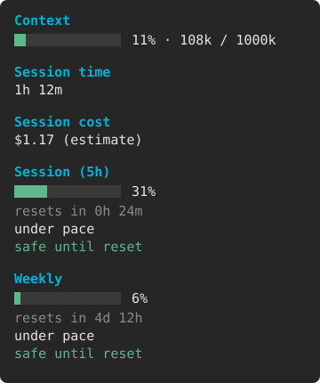

# claude-usage-limits

A Claude Code mod that adds a **Usage** tab to the file-tree panel. It shows your subscription limits and session stats without leaving the window. It is a mod (a plugin with a hooks module), not a skill.



The images are hand-drawn mockups of the tab, not screenshots.

## What it shows

- **Context:** how full the context window is, with token counts.
- **Session time:** how long the session has been running.
- **Session cost:** the estimated cost so far. It is an estimate, not your bill.
- **Session (5h) and Weekly limits:** percent used, time until reset, a pace hint (`ahead of pace`, `on pace`, `under pace`) and a projection (`hits 100% in …` or `safe until reset`). The projection assumes your burn rate so far continues.
- **Alerts:** a toast when a limit passes 80% and 90%, and when a window resets.
- The tab redraws once a minute, so times and countdowns follow the clock.

The limits only exist on a Claude subscription login. On an API key the tab says "No subscription limits yet."

## Cache keep-alive


A toggle that re-reads your session's prompt cache about every 50 minutes, so it doesn't expire after one hour. Each ping sends a one-word request over your session's own transcript. It costs one cache read of your whole context and counts toward your limits.

- It skips a ping if a real turn happened recently.
- It stops itself after **Max idle pings** pings with no turn from you (default 4, about 3 hours). Set 1 to 48 in the tab and press Enter.
- It can't ping before the first turn of a session or right after `/clear`.

## Install

At the prompt of a terminal session:

```
/plugin install usage-limits --marketplace AriVenatus/claude-usage-limits
```

From a shell:

```
claude plugin install usage-limits --marketplace AriVenatus/claude-usage-limits
```

In the desktop app: click + next to the prompt box, then Plugins, Add marketplace with `AriVenatus/claude-usage-limits`, then Add plugin.

The tab opens at session start. A terminal narrower than about 110 columns doesn't dock it beside the chat.

## License

MIT
