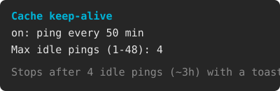

# claude-usage-limits

A Claude Code mod that adds a **Usage** pane beside the chat. It runs standalone; with the [claude-code-filetree](https://github.com/data-goblin/claude-code-filetree) plugin installed it shows up as a tab next to the Files tab.


The images are mockups, not screenshots.

## Shows

- Context fill, session time and estimated session cost
- Session (5h) and weekly limits: percent used, time to reset, pace hint and projected hit time
- Toasts at 80% and 90% of a limit, and when a window resets

Limits need a Claude subscription login; on an API key the tab says "No subscription limits yet."

## Cache keep-alive



A toggle that pings your session's prompt cache every ~50 minutes so it doesn't expire after an hour. Each ping is one cache read of your whole context and counts toward your limits. It skips pings while you're active and stops after **Max idle pings** (1-48, default 4, about 3 hours) with no turn from you.

## Install

```
/plugin install usage-limits --marketplace AriVenatus/claude-usage-limits
```

In the desktop app: + next to the prompt box, Plugins, Add marketplace with `AriVenatus/claude-usage-limits`, then Add plugin. The terminal needs about 110 columns to dock the tab.

## License

MIT
